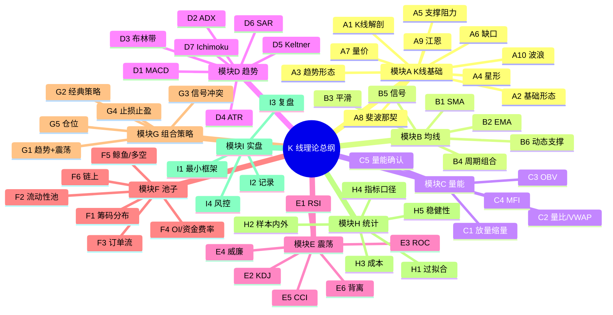

# 量化学习总纲与理论清单（Day 1）

**定位**：这是「量化系统性学习计划」的总纲。它只做一件事——**列出所有要学的理论**，作为后面每一篇 blog 的索引。

---

## 1. 规则（固定下来）

- **学习 = 纯理论**：专攻 K 线 / 技术指标体系。目标是把「均线」「池子」「缩量放量」「斐波那契」「江恩」「波浪」这类术语，一个都不留地吃透。
- **实践 = 写策略验证**：以 BTC 等虚拟货币为主标的，把学到的每个指标写成可回测的策略，用它来巩固理论理解（不追求稳赚，追求看懂）。
- **一个文件 = 一个或几个知识点**：后续每篇 blog 只讲透 1~3 个知识点，并配一个「最小策略验证」。
- **配图**：K 线 / 形态类知识点，每个都拿一张 K 线 SVG 插图来说明（插图放在 `assets/` 下，正文引用）。
- **本文件 = 总纲**：课程大纲（全部要学的知识点）在这里，编号稳定，后面的文件按编号引用。

> 你提到的「池子」归到 **模块 F：筹码 / 资金 / 流动性池**；「斐波那契 / 江恩 / 波浪」归到 **模块 A：K 线基础与读盘**（作为图形学派，A8~A10）。

---

## 2. 学 — 写 — 验 闭环（每个知识点固定五要素）

每篇 blog 讲一个知识点时，必须包含：

1. **术语定义**：它是什么，读盘时看什么。
2. **计算口径**：指标怎么算（公式 / 周期 / 参数），不同口径差异。
3. **常见用法**：趋势 / 震荡 / 止损 / 仓位，各自场景。
4. **坑与误区**：哪些行情下失效，过拟合点在哪。
5. **最小策略验证**：一段 BTC 回测脚本 + 指标表 + 结论留白。

> K 线 / 形态类知识点额外要求：**配一张 K 线 SVG 插图**。

---

## 3. 理论课程大纲（全部要学的知识点）

### 模块 A：K 线基础与读盘
- **A1** 单根 K 线解剖（开盘 / 收盘 / 最高 / 最低 / 影线 / 实体）
- **A2** K 线形态：十字星、锤子 / 上吊、吞没、孕线
- **A3** K 线形态：红三兵 / 三兵、三只乌鸦、刺透 / 乌云盖顶
- **A4** K 线形态：启明星 / 黄昏星及变体
- **A5** 支撑与阻力：水平位、动态位、趋势线
- **A6** 缺口（gap）与回补
- **A7** 量价关系入门：放量 / 缩量 / 天量 / 地量的基本语义
- **A8** 斐波那契：回撤（23.6 / 38.2 / 50 / 61.8 / 78.6）与扩展 / 时间周期（1.272 / 1.618 / 2.618）
- **A9** 江恩：角度线（Gann 1x1 / 2x1 / 1x2）、方阵、十二宫
- **A10** 波浪理论：5 推动 + 3 调整、子浪、波浪 × 斐波那契

### 模块 B：均线（MA）家族
- **B1** 简单移动平均 SMA（含义、周期选择）
- **B2** 指数移动平均 EMA（权重、响应速度）
- **B3** 加权 / 平滑：WMA、DEMA、TEMA、KAMA
- **B4** 常用周期组合（5/10/20/60/120/250 与 周线 / 月线）
- **B5** 均线信号：金叉 / 死叉、多头 / 空头排列、粘合与发散
- **B6** 均线作为动态支撑 / 阻力

### 模块 C：成交量 / 量能指标
- **C1** 成交量基础：放量、缩量、天量、地量、量价背离
- **C2** 量比与 VWAP（成交量加权均价）
- **C3** OBV（能量潮）
- **C4** MFI（资金流量指标）
- **C5** 量能确认：突破是否有效、假突破识别

### 模块 D：趋势类指标
- **D1** MACD（DIF / DEA / 柱、金叉死叉、顶底背离）
- **D2** ADX 与 DMI（趋势强度、方向）
- **D3** 布林带（中轨、带宽、开口 / 收口、squeeze 挤压）
- **D4** ATR（真实波幅、波动率、止损参考）
- **D5** Keltner 通道
- **D6** 抛物线 SAR（跟踪止损）
- **D7** 一目均衡表 Ichimoku（云层、转换线、基准线）

### 模块 E：震荡 / 超买超卖指标
- **E1** RSI（超买超卖、中性区、背离）
- **E2** KDJ / 随机指标（K / D / J 值、J 值极端）
- **E3** ROC（变化率）
- **E4** 威廉指标 W&R
- **E5** CCI（特殊相对指标、+100 / -100 区）
- **E6** 多指标背离综合（价格与指标背离、顶 / 底背离）

### 模块 F：筹码 / 资金 / 流动性池（「池子」）
- **F1** 筹码分布 / 成本分布（筹码峰、套牢盘、获利盘）
- **F2** 流动性池（现货池 vs 永续资金、AMM 流动性视角）
- **F3** 订单流 / 盘口（order book 深度、bid / ask、吃单 / 挂单）
- **F4** 持仓量 Open Interest 与资金费率
- **F5** 主力资金 / 鲸鱼流向、多空比、爆仓数据
- **F6** 链上指标（交易所流入流出、巨鲸持仓、代币分布）

### 模块 G：多指标结合与策略化
- **G1** 趋势确认 + 震荡择时的组合思路
- **G2** 经典指标策略：均线策略、MACD 策略、布林均值回归、RSI 策略
- **G3** 信号冲突与优先级（指标打架时怎么裁决）
- **G4** 止损 / 止盈的指标化（ATR 止损、指标反转）
- **G5** 仓位管理：风险定额、仓位与 ATR / 资金挂钩

### 模块 H：统计与稳健性（支撑实践验证）
- **H1** 过拟合诊断（参数敏感性、区间稳定性）
- **H2** 样本内 / 样本外划分
- **H3** 交易成本建模（滑点、手续费、资金费率）
- **H4** 评估指标口径（收益、夏普、最大回撤、胜率、盈亏比）
- **H5** 稳健性检验（多区间、重抽样、对照组）

### 模块 I：实盘验证与复盘（BTC 实践）
- **I1** 把指标写成可回测信号（最小实验框架）
- **I2** 结果记录：指标表、实验编号、复现条件
- **I3** 复盘：为什么赢、为什么亏，归因
- **I4** 实盘小额验证与风控（仓位上限、单日跌幅上限）

---

## 4. 总纲思维导图

---

## 5. 文件规划（每篇 blog = 1~3 个知识点 + 最小验证）

| 文件 | 主题 | 覆盖知识点 |
| --- | --- | --- |
| 02 | 模块 A：K 线基础与读盘 | A1~A7 |
| 03 | 模块 A：图形学派（斐波那契 / 江恩 / 波浪） | A8~A10 |
| 04 | 模块 B：均线计算（SMA / EMA / 平滑） | B1~B3 |
| 05 | 模块 B：均线信号与支撑阻力 | B4~B6 |
| 06 | 模块 C：成交量 / 量能 | C1~C4 |
| 07 | 模块 D：MACD | D1 |
| 08 | 模块 D：趋势强度与通道 | D2~D5 |
| 09 | 模块 D：SAR / Ichimoku | D6~D7 |
| 10 | 模块 E：超买超卖指标 | E1~E5 |
| 11 | 模块 E：背离综合 | E6 |
| 12 | 模块 F：筹码与流动性池 | F1~F3 |
| 13 | 模块 F：OI / 资金费率 / 链上 | F4~F6 |
| 14 | 模块 G：多指标组合与策略 | G1~G3 |
| 15 | 模块 G：止损止盈与仓位 | G4~G5 |
| 16 | 模块 H：统计与稳健性 | H1~H5 |
| 17 | 模块 I：实盘验证与复盘 | I1~I4 |

> 编号 A~I 是**稳定引用**，不会变；文件号（02~17）是**建议切分**，实际写作时可合并或拆细，以知识点讲透为准。

---

## 6. 质量门（每篇 blog 自检）

- 一个知识点讲透：定义、口径、用法、误区、最小验证，五要素齐全。
- K 线 / 形态类知识点**必须配 SVG 插图**。
- 最小验证必须可复现：参数、周期、数据区间、随机种子。
- 结论有留白：不写「稳赚」，写「在 X 条件下可能稳健」。
- 标注指标失效场景（过拟合点）。
- 附可复现产物：脚本 / 指标表 / 结果截图。

---

## 7. Day 1 行动清单

- [x] 把 01 重写为「总纲 + 理论清单 + 思维导图」
- [x] 写 02：模块 A（A1~A7 K 线解剖 / 形态 / 支撑阻力 / 缺口 / 量价）+ 7 张 K 线 SVG 插图（`public/assets/quant/`）
- [ ] 确认 BTC 行情数据源（K 线、OI、资金费率）
- [ ] 建一个最小回测骨架：数据读入 → 信号 → 指标表 → 复盘

---

## 8. 系列地图

02~03 模块 A（K 线基础 + 图形学派）→ 04~05 模块 B（均线）→ 06 模块 C（量能）→ 07~09 模块 D（趋势指标）→ 10~11 模块 E（震荡指标）→ 12~13 模块 F（筹码 / 池子）→ 14~15 模块 G（多指标组合）→ 16 模块 H（统计稳健性）→ 17 模块 I（实盘复盘）。

> 每篇都按「五要素 + 质量门」走。不存在「已经完成」的第一篇，只存在「已经更近一步」的第一篇。

---

::: info 系列导航
**上一篇**：[系列首页（量化学习计划）](./README.md)
**下一篇**：[02 模块 A：K 线基础与读盘（A1~A7）](./02-模块A-K线基础与读盘.md)
:::
