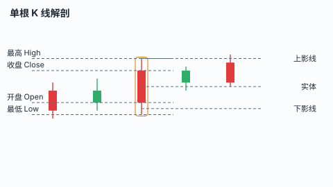
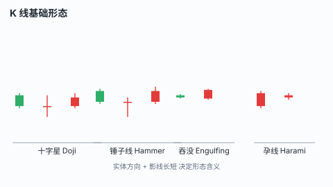
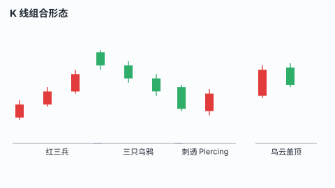
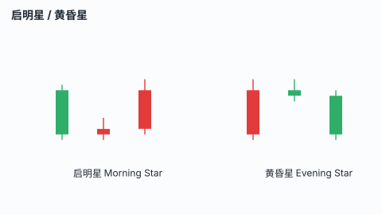
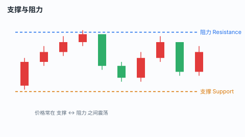
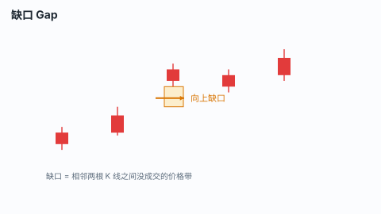
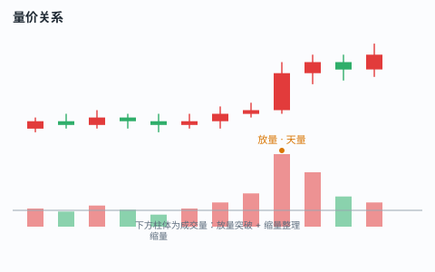

# 模块 A：K 线基础与读盘

> 对应 [01 总纲](./01-量化系统性学习计划.md) 模块 A（A1~A7）。本篇每个知识点配一张 K 线 SVG 插图。
> 学习节奏：纯理论先吃透概念，**最小验证**只给「怎么用 BTC 回测」的配方，可执行脚本统一在 **模块 I** 落地。

---

## A1 单根 K 线解剖

一根 K 线 = 一个周期内的 **OHLC**（开盘 Open、收盘 Close、最高 High、最低 Low）：

- **实体** = O 与 C 之间的粗块；**上影线** = C→H；**下影线** = O→L。
- 阳线（收 > 开，红）/ 阴线（收 < 开，绿）。
- 影线越长，说明该方向被「打回来」越多，是多空拉锯的直观体现。

---

## A2 基础形态：十字星 / 锤子 / 吞没 / 孕线

| 形态 | 特征 | 常出现位置 | 含义 |
| --- | --- | --- | --- |
| 十字星 Doji | 开 ≈ 收，影线长 | 趋势末端 | 多空势均，可能转向 |
| 锤子线 Hammer | 长下影 + 小实体 | 下跌末端 | 下探被拉回，潜在见底 |
| 吞没 Engulfing | 后一根实体包住前一根 | 反转点 | 方向力量切换 |
| 孕线 Harami | 前大后小被包住 | 动能减弱 | 趋势可能放缓 |

**最小验证**：BTC 4h，识别「锤子线 + 放量」后 N 根的收益分布，对比「随机 K 线 + 放量」对照组；看锤子线是否真有见底优势，还是只在特定区间成立。

---

## A3 组合形态：红三兵 / 三只乌鸦 / 刺透 / 乌云盖顶

- **红三兵**：三根连续阳线、重心逐步抬高 → 强势上涨。
- **三只乌鸦**：三根连续阴线、重心逐步下移 → 弱势下跌。
- **刺透**：阴线后一根阳线开盘低于前收、收盘穿回前实体一半以上 → 潜在见底。
- **乌云盖顶**：阳线后一根阴线开盘高于前高、收盘穿入前实体一半以下 → 潜在见顶。

**最小验证**：BTC 1d，统计「红三兵」出现后 5 日收益的均值与胜率；对照「任意三连阳」，看是否有溢价。

---

## A4 三星：启明星 / 黄昏星

- **启明星**：长阴 → 小实体 → 长阳，下跌末端反转信号。
- **黄昏星**：长阳 → 小实体 → 长阴，上涨末端反转信号。
- 中间那根（星体）实体越小、与上下两根分离越远，信号越强。

**最小验证**：BTC 4h，识别完整三星后 3 根方向，与「任意三 K」对照；记录触发位置（是否靠近 A5 的支撑 / 阻力）对胜率的影响。

---

## A5 支撑与阻力

- **支撑**：下方多次止跌的价格带；**阻力**：上方多次止涨的价格带。
- 被触及次数越多、成交量越大，级别越高；**突破后角色互换**（支撑变阻力、阻力变支撑）。
- 水平位（前高 / 前低）比斜的趋势线更稳。

**最小验证**：BTC 1d，自动找「30 日内被触及 ≥ 3 次」的水平价位作为 S/R，统计价格触 S/R 后 3 根反转 vs 突破的比例；看「突破」是否比「反转」收益更稳。

---

## A6 缺口（Gap）

- 缺口 = 相邻两根 K 线之间**没成交的价格带**（前一根 H < 后一根 L 为向上缺口）。
- 常见类型：突破缺口、持续缺口、衰竭缺口；缺口常是后续回补的目标。

**最小验证**：BTC 是 7×24，真正「跳空」很少，更多来自**资金费率 / 大户异动**造成的价格带；统计「缺口出现 → 回补」的时滞与幅度，看回补是否可作为反向信号。

---

## A7 量价关系（放量 / 缩量 / 天量 / 地量）

- **放量**：成交量显著高于近期均值 → 信号可信度上升。
- **缩量**：成交量萎缩 → 动能不足，趋势可能延续也可能衰竭。
- **天量**：极端高量，常出现在大转折；**地量**：极端低量，常在趋势末端。
- 核心：**价格突破必须配合放量**，否则易为假突破。

**最小验证**：BTC 1h，用 20 期成交量均值定义「放量 = 量 > 1.5×均值」，统计放量 K 线后 3 根方向命中率 vs 缩量 K 线；这是后面模块 C（量能）的地基。

---

## 本篇小结

| 知识点 | 核心读盘点 | 失效场景 |
| --- | --- | --- |
| A1 单根 K 线 | 实体 / 影线方向 | 单独一根 K 线无意义，必须看位置 |
| A2 基础形态 | 位置 > 形态 | 强趋势中反转形态多为假信号 |
| A3 组合形态 | 重心移动方向 | 震荡市频繁触发 |
| A4 三星 | 星体越小越强 | 远离支撑阻力时失效 |
| A5 支撑阻力 | 被触次数 / 成交量 | 突破后需确认，假突破多 |
| A6 缺口 | 缺口会回补 | BTC 7×24 真跳空少 |
| A7 量价 | 突破要放量 | 缩量突破多为假突破 |

> 下一步：**模块 B（均线家族）**。K 线形态负责「看到什么」，均线负责「把趋势量化成信号」。

---

[← 上一页：01 量化学习总纲与理论清单](./01-量化系统性学习计划.md) · [下一页：03 模块 A：图形学派（斐波那契 / 江恩 / 波浪） →](./03-模块A-图形学派.md)

---

::: info 系列导航
**上一篇**：[01 量化学习总纲与理论清单](./01-量化系统性学习计划.md)
**下一篇**：[03 模块 A：图形学派（斐波那契 / 江恩 / 波浪）](./03-模块A-图形学派.md)
:::
