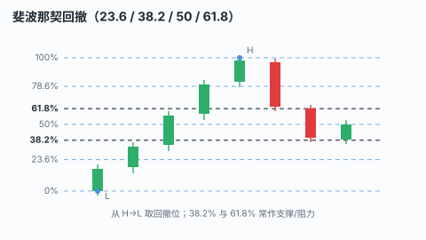
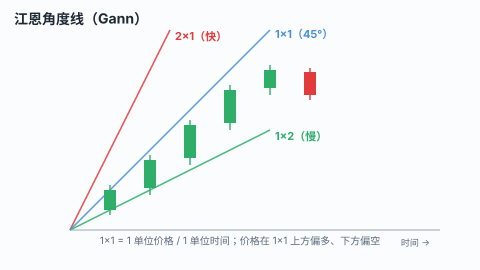
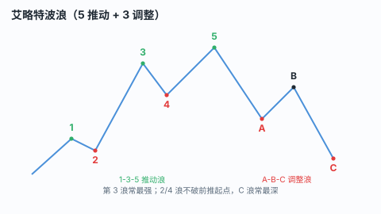

# 模块 A：图形学派（斐波那契 / 江恩 / 波浪）

> 对应 [01 总纲](./01-量化系统性学习计划.md) 模块 A 的 **A8~A10**。延续 [02 的 K 线基础](./02-模块A-K线基础与读盘.md)，这一篇讲三个「图形学派」工具：斐波那契、江恩、艾略特波浪。每个知识点配一张图，最小验证只给「怎么用 BTC 回测」的配方（可执行脚本统一在 **模块 I** 落地）。

**配色约定**：绿涨 / 红跌（国际惯例；A 股红涨绿跌）。

---

## A8 斐波那契回撤 / 扩展

- **定义**：取一段价格波动的最高 H、最低 L，按 H↔L 距离的比例（23.6 / 38.2 / 50 / 61.8 / 78.6%）画水平位，价格回调常在这些位附近企稳或受阻。
- **计算口径**：回撤比例基于 `H − L`；**扩展**（1.272 / 1.618 / 2.618）把目标往外推；**时间周期（Fib Time Zones）** 把横轴时间也按斐波那契数列切分。
- **常见用法**：上升趋势回调找支撑（重点看 38.2 / 50 / 61.8）；下降反弹找阻力；与成交量（模块 C）叠加确认。
- **坑与误区**：回撤位是「概率区」不是「精确点」；单边趋势里会被直接打穿；别只盯一个位，要看整组。
- **最小验证（BTC）**：4h / 1d，标记近 3 个月高低点画回撤，统计价格触及 **38.2% / 61.8%** 后 N 根 K 线的「反弹 vs 破位」比例；对照组 = 随机水平位。

---

## A9 江恩角度线

- **定义**：从某起点画出 2×1 / 1×1 / 1×2 等不同斜率的直线，把「价格 vs 时间」几何化。价格在 1×1 上方偏多、下方偏空。
- **计算口径**：1×1 = 45°（1 单位价格 / 1 单位时间）；倍数表示价格相对时间的快慢；**江恩方阵 / 十二宫** 用数字关系（9/8/15…）预测关键时点。
- **常见用法**：趋势里以 1×1 当「公平线」，价格站上方偏强；用 2×1 找突破、1×2 找整理。
- **坑与误区**：角度线强依赖「价格 / 时间单位」的归一化，不同 K 线周期、不同交易所结果完全不同；江恩时数 / 方阵偏经验，务必先历史检验再用。
- **最小验证（BTC）**：固定 1d 周期，从一波大低点画 1×1，统计价格**穿越 1×1** 后的方向命中率；对照「均线金叉（模块 B）」。

---

## A10 艾略特波浪

- **定义**：市场以「**5 推动浪（1-3-5）+ 3 调整浪（A-B-C）**」循环推进；推动浪顺大势，调整浪逆大势。
- **计算口径（三大铁律）**：① 2 浪不能跌破 1 浪起点；② 3 浪通常不是最短的推动浪；③ 4 浪不能进入 2 浪领地（不能重叠）。
- **常见用法**：数浪 → 判断当前处于推动 / 调整的哪一段 → 结合斐波那契（③=①×1.618、⑤=③×0.618、C=B×1.618）定目标位。
- **坑与误区**：数浪高度主观、事后才「对」；加密 7×24 市场里，**长周期浪更稳、短周期常数错**；一根 K 线可属于多个子浪。
- **最小验证（BTC）**：1d 手工数一波完整的 5-3，检验「③ 浪最强、C 浪常最深」是否成立；统计 ③ 浪相对 ① 浪的长度分布。

---

## 本篇小结

| 知识点 | 核心读盘点 | 失效场景 |
| --- | --- | --- |
| A8 斐波那契 | 回撤比例是「概率区」 | 单边趋势直接打穿 |
| A9 江恩 | 1×1 为公平线 | 单位 / 周期归一化不一致 |
| A10 波浪 | 三大铁律 + 数浪 | 主观、短周期易数错 |

> 图形学派偏「经验 + 概率」，务必用模块 H（统计稳健性）的方法检验后再谈实盘。

---

::: info 系列导航
**上一篇**：[02 模块 A：K 线基础与读盘（A1~A7）](./02-模块A-K线基础与读盘.md)
**下一篇**：[04 模块 B：均线计算（SMA / EMA / 平滑）](./04-模块B-均线计算.md)
:::
