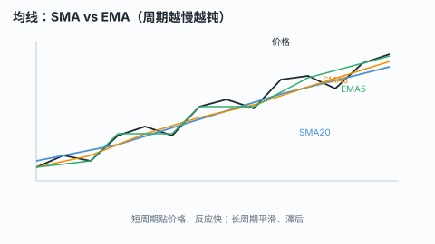

# 模块 B：均线计算（SMA / EMA / 平滑）

> 对应 [01 总纲](./01-量化系统性学习计划.md) 模块 B 的 **B1~B3**。均线是第一个「把趋势量化成信号」的工具——它不预测，只平滑。

## B1 简单移动平均（SMA）

- **定义**：过去 N 根 K 线收盘价的算术平均，代表「N 根内的平均持仓成本」。
- **计算口径**：`SMA_N = (C₁+…+C_N)/N`，逐根前移；N 越大越平滑、越滞后。
- **常见用法**：N<20 偏短线、20~60 中线、>60 长线；价格站上/跌破、金叉死叉、动态支撑阻力。
- **坑与误区**：本质滞后（反转要等均线拐头）；震荡市反复打脸；「用哪条 N」是经验不是真理。
- **最小验证（BTC）**：4h 上算 SMA20，统计「价格上穿 SMA20」后 N 根的期望收益，对照「未上穿」；看是否正期望、是否跨 3 年区间都稳。

## B2 指数移动平均（EMA）

- **定义**：对近期价格加权更大的 MA，比 SMA 反应快。
- **计算口径**：`EMA_t = α·C_t + (1−α)·EMA_{t−1}`，`α = 2/(N+1)`；N 越小 α 越大、越贴价格。
- **常见用法**：短周期趋势过滤；12/26 是 MACD 的原料（模块 D）；双 EMA 交叉做信号。
- **坑与误区**：只是「更灵敏的平滑」，没改变滞后本质；参数同样靠经验。
- **最小验证（BTC）**：「上穿 EMA20」 vs「上穿 SMA20」：对比信号数量、胜率、平均持仓时长——看灵敏度的代价（更多假信号？）。

## B3 自适应平滑（KAMA / ATR）

- **定义**：用「效率比」自适应系数（KAMA）或 ATR（真实波幅），让指标趋势中跟得快、震荡中放得平。
- **计算口径**：`KAMA 系数 = [ER·α]²`，ER（效率比）越小越平；`ATR = mean(TR, N)`，`TR = max(H−L, |H−C_prev|, |L−C_prev|)`。
- **常见用法**：用「指标动没动」判断当下是否该跑趋势策略；ATR 分位数做动态止损（模块 G）。
- **坑与误区**：KAMA 实现易写错递推；ATR 也是滞后的波动度量，不是预测。
- **最小验证（BTC）**：KAMA 与 SMA 同信号对比；用 14 日 ATR 分位做「带宽止损」，看比固定百分比止损的夏普是否更好。

## 本篇小结

| 知识点 | 核心读盘点 | 失效场景 |
| --- | --- | --- |
| B1 SMA | 平滑=平均成本，N 越大越钝 | 反转滞后、震荡打脸 |
| B2 EMA | 加权近端、更快 | 仍是平滑，非预测 |
| B3 KAMA/ATR | 趋势快 / 震荡平 | 实现易错、ATR 也滞后 |

> 均线负责「趋势信号」，但都是滞后指标——模块 C（量）补「确认」，模块 D（动能/通道）补「边界」。

---

::: info 系列导航
**上一篇**：[03 模块 A：图形学派（斐波那契 / 江恩 / 波浪）](./03-模块A-图形学派.md)
**下一篇**：[05 模块 B：均线信号与支撑阻力](./05-模块B-均线信号与支撑阻力.md)
:::
