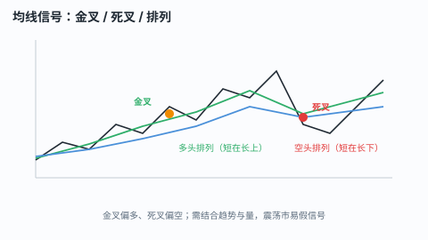
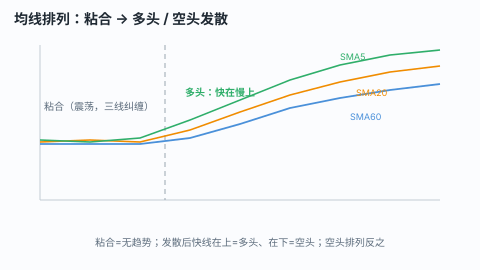
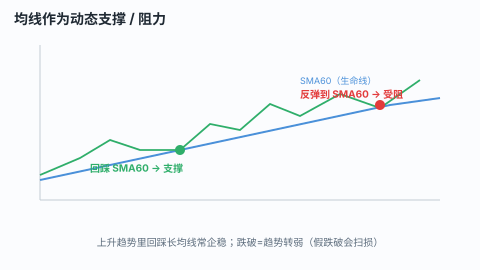

# 模块 B：均线信号与支撑阻力

> 对应 01 总纲 模块 B 的 **B4~B6**。有了均线计算，这一篇讲怎么把它变成「可执行信号」，并和支撑阻力（A6）结合。

## B4 金叉 / 死叉

- **定义**：短期均线上穿长期均线 = 金叉（偏多）；下穿 = 死叉（偏空）。
- **计算口径**：信号发生在 `SMA_fast > SMA_slow` 由假变真的那一根；快慢周期（如 5/20、12/26）是经验。
- **常见用法**：单均线系统的进出场；双均线策略（多/空双向或只做多）。
- **坑与误区**：震荡市金叉死叉反复出现（whipsaw），是最大杀手；「快慢比」没有普适最优，需按标的/周期定。
- **最小验证（BTC）**：1d 上 5/20 双均线，双向策略，统计 3 年胜率、盈亏比、最大回撤；再换成 20/60，看慢均线是否更少假信号、但入场更晚。

## B5 均线排列（多/空头）

- **定义**：短在中上、中在长上 = 多头排列；反之为空头排列；纠缠 = 无趋势（震荡）。
- **计算口径**：比较 SMA5 / SMA20 / SMA60 的相对位置；可用「排列是否单调」做趋势过滤器。
- **常见用法**：只在多头排列里做多、空头排列里做空/观望——把双均线信号当「趋势过滤器 + 触发器」。
- **坑与误区**：排列是滞后的；「刚转多头」往往已经涨了一段；排列+触发器会错过反转前段。
- **最小验证（BTC）**：「排列过滤 + 金叉触发」 vs「裸金叉」：对比胜率、最大回撤、错过幅度，判断过滤器是否真的降回撤。

## B6 均线作为支撑 / 阻力

- **定义**：上升趋势里价格回踩长均线常被接住（支撑）；下降反弹到长均线受阻（阻力）。
- **计算口径**：取 20/60/200 日均线；「回踩不破 + 放量」= 有效支撑信号。
- **常见用法**：趋势回调买入；把长均线当「趋势生命线」，跌破则离场。
- **坑与误区**：支撑/阻力是「概率区」不是精确线；假跌破（扫损）很常见；均线越久越关键但越不敏感。
- **最小验证（BTC）**：统计「价格回踩 SMA60 且当日放量」后 N 根的多空表现，对照「未回踩」；看回踩支撑是否正期望。

## 本篇小结

| 知识点 | 核心读盘点 | 失效场景 |
| --- | --- | --- |
| B4 金叉死叉 | 短穿长做信号 | 震荡反复打脸 |
| B5 均线排列 | 多/空/纠缠三分 | 滞后、错过反转前段 |
| B6 支撑阻力 | 长均线当生命线 | 假跌破扫损 |

> 均线信号 = 触发器；模块 C（量）= 确认器，两者叠加能过滤掉大半假信号。

---

::: info 系列导航
**上一篇**：[04 模块 B：均线计算（SMA / EMA / 平滑）](./04-模块B-均线计算.md)
**下一篇**：[06 模块 C：成交量与量能（OBV / 量比）](./06-模块C-成交量与量能.md)
:::
