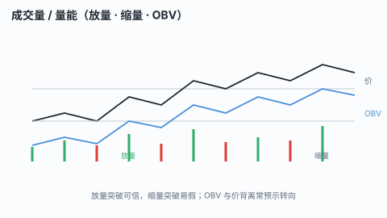

# 模块 C：成交量与量能（OBV / 量比）

> 对应 01 总纲 模块 C 的 **C1~C4**。价是「结果」，量是「燃料」——量告诉你趋势有没有人真金白银地买。

## C1 放量 / 缩量

- **定义**：成交量明显高于近期平均 = 放量；明显低于 = 缩量。放量代表分歧大、参与度高。
- **计算口径**：常与「N 日均量」比（量比 = 当日量 / N 日均量）；或用量的 Z-score 判异。
- **常见用法**：放量突破更可信、缩量反弹易假；放量滞涨（价不动量很大）常是顶部。
- **坑与误区**：「放量」要看相对自己历史，不是绝对值；加密 7×24 无隔夜跳空参照；单根放量可能是刷量/插针。
- **最小验证（BTC）**：统计「突破 + 量比>2」 vs「突破 + 量比<1」后 N 根的表现差；看放量是否真的提升胜率。

## C2 量价关系（量增价升 / 量缩价升 …）

- **定义**：把「量的变化」与「价的变化」配对读：量增价升（健康多头）、量缩价升（动能不足）、量增价跌（恐慌/出货）…
- **计算口径**：按当根 `Δ价 × Δ量` 的符号组合分桶。
- **常见用法**：趋势延续需「量价配合」；背离（价新高量萎缩）是隐患。
- **坑与误区**：分桶边界主观；加密量是「交易所量」，跨所合计才全；刷量会污染。
- **最小验证（BTC）**：把成交按 4 象限（价± × 量±）分桶，统计各桶后 N 根期望收益，看哪象限是正期望。

## C3 OBV（能量潮）

- **定义**：按当日涨/跌把成交量累加/扣减，得到一条「量能趋势」线，用于判断价格方向有没有量支持。
- **计算口径**：`OBV_t = OBV_{t−1} ± V_t`（涨加、跌减、平不变）；看 OBV 与价的相对趋势。
- **常见用法**：OBV 创新高先于价 = 提前看多；OBV 与价背离（模块 E）预警转向。
- **坑与误区**：OBV 绝对值无意义（只看斜率/背离）；加密跨所量合计后才有意义。
- **最小验证（BTC）**：「OBV 与价同向」 vs「OBV 背离」两组，统计后续 N 根方向命中率差。

## C4 量比 / VWAP 与日内节奏

- **定义**：量比 = 量 / N 日均量；VWAP = 成交量加权均价（日内锚点），偏离 VWAP 幅度反映强弱。
- **计算口径**：`VWAP = Σ(价格×量)/Σ量`（日内累计）；偏离 = (价−VWAP)/VWAP。
- **常见用法**：日内趋势跟随 VWAP；量比放大确认突破。
- **坑与误区**：VWAP 跨日会失真（需每日重置）；量比依赖「基准日」选择。
- **最小验证（BTC）**：日内 5m，「价在 VWAP 上方 + 量比>1.5」做多的胜率；对照「任意时刻」。

## 本篇小结

| 知识点 | 核心读盘点 | 失效场景 |
| --- | --- | --- |
| C1 放/缩量 | 相对自身历史判异 | 绝对量无意义、刷量 |
| C2 量价配合 | 四象限分桶 | 边界主观 |
| C3 OBV | 看斜率/背离不看绝对值 | 需跨所合计 |
| C4 VWAP | 日内锚点，每日重置 | 跨日失真 |

> 量是「确认器」——和模块 B 的均线触发器叠加，能过滤掉多数假突破。

---

::: info 系列导航
**上一篇**：[05 模块 B：均线信号与支撑阻力](./05-模块B-均线信号与支撑阻力.md)
**下一篇**：[07 模块 D：MACD（DIF / DEA / 柱）](./07-模块D-MACD.md)
:::
