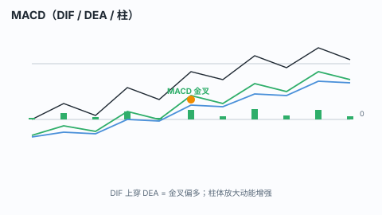

# 模块 D：MACD（DIF / DEA / 柱）

> 对应 01 总纲 模块 D 的 **D1**。MACD 把「两条 EMA 的差」做成动能 + 趋势双重指标，是最常用的单指标之一。

## D1 MACD 的三条线

- **定义**：`DIF = EMA12 − EMA26`（快线）；`DEA = EMA(DIF, 9)`（慢线）；`柱 = 2×(DIF−DEA)`（柱状图）。三者合力读动能。
- **计算口径**：参数 12/26/9 是 Gordon 经验值；柱放大=动能增强，柱缩短=动能减弱。
- **常见用法**：
  - **金叉/死叉**：DIF 上穿 DEA 偏多、下穿偏空（0 轴附近更可靠）。
  - **零轴上下**：DIF 在 0 上 = 中期偏多；下穿 0 = 趋势转空。
  - **背离**：价与 DIF 背离（模块 E）。
- **坑与误区**：MACD 是滞后指标（基于 EMA）；震荡市金叉死叉密集；「0 轴」不是铁律，只是动能分界；柱是放大/缩小的 DIF−DEA，不是绝对量。
- **最小验证（BTC）**：1h/4h 上「0 轴上方 + DIF 金叉」做多，统计 3 年胜率、盈亏比、最大回撤；再对比「不要求 0 轴」，看 0 轴过滤是否提胜率还是只是减信号。

## 本篇小结

| 读法 | 信号 | 注意 |
| --- | --- | --- |
| 金叉/死叉 | DIF 穿 DEA | 震荡市假信号多 |
| 零轴 | DIF 在 0 上/下 | 中期方向过滤 |
| 柱体 | 放大/缩短 | 动能强弱 |
| 背离 | 价 vs DIF | 趋势末端最强（模块 E） |

> MACD 是「动能 + 趋势」的折中：既看快慢线差，又看相对 0 轴的位置。下一篇讲它之外的一族「边界」指标。

---

::: info 系列导航
**上一篇**：[06 模块 C：成交量与量能（OBV / 量比）](./06-模块C-成交量与量能.md)
**下一篇**：[08 模块 D：趋势强度与通道（布林带 / ATR）](./08-模块D-趋势强度与通道.md)
:::
