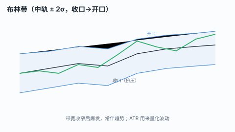

# 模块 D：趋势强度与通道（布林带 / ATR / ADX / 唐奇安）

> 对应 01 总纲 模块 D 的 **D2~D5**。这一族解决两件事：**趋势强不强**（ADX）和**边界在哪**（布林带 / 通道）。

## D2 布林带（Bollinger Bands）

- **定义**：`中轨 = SMA20`；`上/下轨 = 中轨 ± 2×σ(20)`。价格相对「波动带」的位置就是强弱。
- **计算口径**：σ 是 20 期真实标准差；带宽 = (上轨−下轨)/中轨，越窄越「挤压」。
- **常见用法**：「收口→开口」抓突破；价格贴下轨偏超卖、贴上轨偏超涨；%B=(价−下轨)/(上轨−下轨) 读相对位置。
- **坑与误区**：贴轨≠立刻反转（单边趋势会一路贴轨走）；带宽是滞后度量；±2σ 只是经验（~95%）。
- **最小验证（BTC）**：1d 上「带宽 20 日低位 + 向上破上轨」做多，统计后 N 根收益；对照「带宽高位同信号」。

## D3 ATR（真实波幅）

- **定义**：`TR = max(H−L, |H−C_prev|, |L−C_prev|)`；`ATR = mean(TR, 14)`。衡量波动大小，**与方向无关**。
- **计算口径**：ATR 是绝对价格/比率，不预测方向；常用来定「几 ATR」的动态止损/止盈。
- **常见用法**：波动率过滤（ATR 过低不做趋势单）；止损 = N×ATR；仓位随 ATR 反比（波动大仓位小）。
- **坑与误区**：ATR 是滞后的波动度量，不是预测；固定 N 没有普适最优；跨周期要归一化。
- **最小验证（BTC）**：用 14 日 ATR 的 5/2/3 倍做三档止损，比固定 2% 止损的夏普 / 回撤，看哪档更稳。

## D4 ADX（趋势强度）

- **定义**：`DI±` 是 ±DI 方向指标，`ADX = mean(|+DI−−DI|, 14)`，衡量「趋势有多强」，与方向无关。
- **计算口径**：ADX>25 偏有趋势、<20 偏震荡；+DI>−DI 偏多、反之为空。
- **常见用法**：ADX 高才跑趋势策略、低就跑均值回归——用 ADX 当「策略切换开关」。
- **坑与误区**：ADX 本身滞后且钝；25/20 是经验门槛；只看 ADX 不看 ±DI 会丢方向。
- **最小验证（BTC）**：「ADX>25 才允许趋势单」 vs「任何时候都允许」，对比策略在震荡段的回撤。

## D5 唐奇安通道 / 波动率突破（海龟核心）

- **定义**：`上通道 = N 日最高`、`下通道 = N 日最低`；价上穿上通道做多、下穿做空（海龟法则）。
- **计算口径**：N 常用 20/55；突破用「通道价」入场，用 ATR 定止损。
- **常见用法**：纯突破系统，趋势强时大赚、震荡时磨损；用「波动率仓位 + ADX 过滤」改善。
- **坑与误区**：突破系统靠少数大趋势赚钱，震荡期大量小额止损；对插针/滑点敏感。
- **最小验证（BTC）**：20 日唐奇安突破，ATR 止损，统计盈亏分布——重点看「前 20% 盈利单贡献了多少总利润」（验证突破系统特性）。

## 本篇小结

| 知识点 | 核心读盘点 | 失效场景 |
| --- | --- | --- |
| D2 布林带 | 收口→开口抓突破 | 单边一路贴轨 |
| D3 ATR | 定波动、定止损，不预测方向 | 滞后 |
| D4 ADX | 趋势/震荡开关 | 门槛是经验、滞后 |
| D5 唐奇安 | 纯突破，靠少数大单 | 震荡磨损、对插针敏感 |

> 「趋势强不强（ADX）+ 边界在哪（通道/布林）」合起来，才能区分该跑趋势还是该等均值。

---

::: info 系列导航
**上一篇**：[07 模块 D：MACD（DIF / DEA / 柱）](./07-模块D-MACD.md)
**下一篇**：[09 模块 D：SAR 与一目均衡表](./09-模块D-SAR与一目均衡.md)
:::
