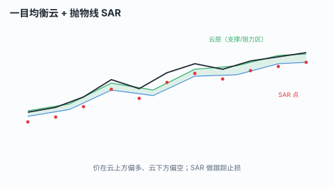

# 模块 D：SAR 与一目均衡表（Ichimoku）

> 对应 01 总纲 模块 D 的 **D6~D7**。两个「自带方向 + 自带止损/支撑阻力」的体系，读完模块 D 就齐了。

## D6 抛物线 SAR（Parabolic SAR）

- **定义**：SAR（Stop And Reverse）是一串「跟踪止损点」，逐期按加速度系数（AF）逼近价格，价跌破 SAR 就翻空。
- **计算口径**：`SAR = SAR_prev + AF×(EP−SAR_prev)`，趋势每创新高 AF 翻倍（有上限）；AF 常 0.02~0.2。
- **常见用法**：趋势跟踪 + 动态止损；SAR 在价下方 = 多头、上方 = 空头。
- **坑与误区**：震荡市 SAR 反复翻转磨损；AF 太小追不上、太大止损太松；加密插针易扫 SAR。
- **最小验证（BTC）**：4h 上 SAR（AF 0.02/0.04）做多/空，统计胜率、盈亏比、磨损次数；看是否「靠少数大趋势覆盖多数小损」。

## D7 一目均衡表（Ichimoku Kinko Hyo）

- **定义**：五条线构成「云端 + 支撑阻力 + 方向」体系：`转换线(9)、基准线(26)、迟行指标、领先指标 A/B（构成云）`。
- **计算口径**：`转换线 = (9日高+9日低)/2`；`基准线 = 26日同`；`领先指标 = (转换线+基准线)/2` 前后移 26 期构成「云」；价格相对云的位置定方向。
- **常见用法**：价在云上偏多、云下偏空；「云越厚支撑/阻力越强」；Kijun/Chikou 交叉做触发。
- **坑与误区**：五条线一起看很乱，新手易「全用」；参数（9/26/52）是经验；云太薄时信号弱。
- **最小验证（BTC）**：1d 上「价上穿厚云 + Chikou 不触线」做多，统计胜率；对照「任意上穿」，看「厚云」是否真提质量。

## 本篇小结

| 知识点 | 核心读盘点 | 失效场景 |
| --- | --- | --- |
| D6 SAR | 跟踪止损，趋势翻多翻空 | 震荡磨损、插针扫损 |
| D7 Ichimoku | 云 = 支撑阻力 + 方向 | 线多易乱、薄云信号弱 |

> SAR 解决「跟住趋势 + 自动止损」，Ichimoku 解决「方向 + 边界 + 触发」三合一。下一篇进入「震荡类」指标。

---

::: info 系列导航
**上一篇**：[08 模块 D：趋势强度与通道（布林带 / ATR / ADX / 唐奇安）](./08-模块D-趋势强度与通道.md)
**下一篇**：[10 模块 E：超买超卖指标（RSI / KDJ / CCI / Williams %R）](./10-模块E-超买超卖指标.md)
:::
