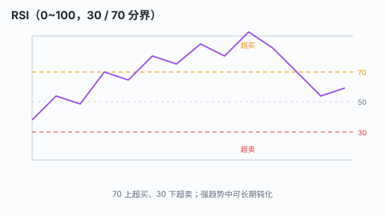

# 模块 E：超买超卖指标（RSI / KDJ / CCI / Williams %R）

> 对应 01 总纲 模块 E 的 **E1~E5**。一族「读动能强弱 + 边界」的震荡类指标，擅长在趋势末端/震荡市找拐点。

## E1 RSI（相对强弱）

- **定义**：`RSI = 100 − 100/(1+RS)`，`RS = 平均上涨/平均下跌（N=14）`；0~100，>70 偏超买、<30 偏超卖。
- **计算口径**：常用 Wilder 平滑（EMA 式）；50 是多空分界。
- **常见用法**：超卖区看多、超买区看空；>70/<30 不是立刻反转，而是「别追」。
- **坑与误区**：强趋势中 RSI 可长期钝化（70+ 一路走）；只用 RSI 会「抄在半山腰」；要结合趋势（模块 D）。
- **最小验证（BTC）**：4h「RSI<30 且价在 SMA20 上方」做多（趋势内超卖回调），统计后 N 根期望收益，对照「RSI<30 无条件」。

## E2 KDJ / 随机指标（Stochastic）

- **定义**：`K` 是收盘价在近期「高—低区间」的相对位置；`D` 是 K 的平滑；`J = 3K−2D`（放大版）。
- **计算口径**：常用 (9,3,3)；>80 超买、<20 超卖；K 上穿 D = 金叉。
- **常见用法**：震荡市 KDJ 金叉死叉较灵敏；J 极端值（>100/<0）抓拐点。
- **坑与误区**：比 RSI 更灵敏 = 假信号更多；趋势市会在极端区钝化；参数敏感。
- **最小验证（BTC）**：1h 上「KDJ 低位金叉」 vs「高位死叉」的胜率与盈亏比，看是否对称。

## E3 CCI（顺势指标）

- **定义**：`CCI = (现价 − 典型价均值)/（0.015×典型价差）`；±100/±200 分界。
- **计算口径**：典型价 = (H+L+C)/3；CCI>100 偏强、<−100 偏弱、±200 极端。
- **常见用法**：±100 当「趋势启动」线；从 −200 回升是早期多头信号（比 RSI 更提前）。
- **坑与误区**：CCI 比 RSI 更早但也更「毛刺」；极端区同样会钝化。
- **最小验证（BTC）**：「CCI 从 −200 上穿 −100」做多 vs「RSI 从 30 上穿」，比谁更早、谁更稳。

## E4 Williams %R（威廉指标）

- **定义**：`%R = (N日高−C)/(N日高−N日低)×100`，范围 0~−100；接近 0 超买、接近 −100 超卖。
- **计算口径**：常用 N=14；>−20 超买、<−80 超卖。
- **常见用法**：比 RSI 更灵敏；常与 RSI 交叉验证（两者同超卖更可信）。
- **坑与误区**：灵敏=噪音多；单用易被打脸；适合「多指标共振」而非单兵。
- **最小验证（BTC）**：「%R<−80 且 RSI<30」共振做多的胜率，对照单指标，看共振是否提质量。

## E5 超买超卖「怎么用」（综合）

- **定义**：超买超卖是「别追」的提示，不是「立刻反着做」的反转信号。
- **计算口径**：先判趋势（模块 D 的 ADX/SAR），再在趋势内用超买超卖找「回调进场点」。
- **常见用法**：上升趋势里等 RSI 回 40~50 区再买（不追 70）；下降趋势里等超卖反弹但不重仓。
- **坑与误区**：把「超卖」当「一定涨」是最大错误；强趋势里超买还能更超买。
- **最小验证（BTC）**：「趋势向上 + RSI 回落到 50」进场 vs「RSI<30 抄底」，对比期望与回撤。

## 本篇小结

| 指标 | 范围 | 特点 | 失效 |
| --- | --- | --- | --- |
| RSI | 0~100 | 最常用、较稳 | 趋势钝化 |
| KDJ | 0~100 | 灵敏、假信号多 | 趋势钝化、参数敏感 |
| CCI | ± | 提前、毛刺 | 噪音 |
| %R | 0~−100 | 最灵敏 | 单用打脸 |

> 震荡类指标的正确姿势：先判趋势，再在趋势内用它找「回调进场」，别拿它抄底摸顶。

---

::: info 系列导航
**上一篇**：[09 模块 D：SAR 与一目均衡表](./09-模块D-SAR与一目均衡.md)
**下一篇**：[11 模块 E：背离综合](./11-模块E-背离综合.md)
:::
