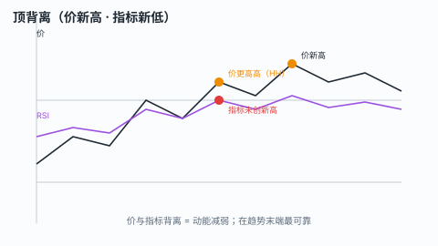

# 模块 E：背离综合（顶 / 底 / 隐蔽）

> 对应 01 总纲 模块 E 的 **E6**。背离是「价与动能不一致」，是趋势末端最有力的预警——但它只「预警」，不「精确预测」。

## E6 背离的四种

- **定义**：**顶背离**（价创新高、指标未新高）、**底背离**（价创新低、指标未新低）= 动能减弱，趋势将衰；**隐蔽顶/底背离**（指标新高/低、价未）= 趋势延续更强。
- **计算口径**：取「两个相近的极值点」比较价与指标（RSI/MACD/OBV）的高低；时间间隔通常 3~20 根。
- **常见用法**：趋势末端顶背离减仓/离场；底背离观察反转；隐蔽背离加码趋势单。
- **坑与误区**：背离可以连续多次（「背离后再背离」），单次背离不是反转；背离只降「继续」的概率，不保证反转；主观选点 → 不同人不同结论。
- **最小验证（BTC）**：1d「顶背离（价新高 + RSI 未新高）」后 N 根的多空表现；对照「价新高但无背离」，看背离是否显著降低上涨概率。

## 本篇小结

| 背离类型 | 含义 | 用在哪 |
| --- | --- | --- |
| 顶背离 | 上行动能衰竭 | 趋势末端减仓 |
| 底背离 | 下行动能衰竭 | 观察反转 |
| 隐蔽顶背离 | 多头更强 | 趋势延续加码 |
| 隐蔽底背离 | 空头更强 | 趋势延续 |

> 背离是「减概率」而非「定结果」——把它当**预警灯**用（配合止损/仓位），别当反转扳机。

---

::: info 系列导航
**上一篇**：[10 模块 E：超买超卖指标（RSI / KDJ / CCI / Williams %R）](./10-模块E-超买超卖指标.md)
**下一篇**：[12 模块 F：筹码与流动性池](./12-模块F-筹码与流动性池.md)
:::
