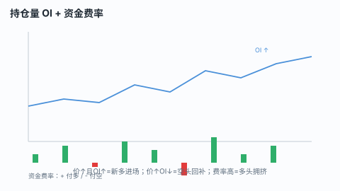

# 模块 F：OI / 资金费率 / 链上资金流（衍生品结构）

> 对应 01 总纲 模块 F 的 **F4~F6**。加密特有：永续合约的 OI 与资金费率，是判断「谁在加杠杆、多头是否拥挤」的最直接窗口。

## F4 持仓量（OI, Open Interest）

- **定义**：未平仓合约数量，反映「市场里真实挂着的杠杆资金」。
- **计算口径**：跨所合计 OI（BTC 主流所）；看 OI 变化率而非绝对值。
- **常见用法**：**价↑ + OI↑** = 新多进场（趋势健康）；**价↑ + OI↓** = 空头回补（涨势弱、易回落）；**价↓ + OI↑** = 新空进场（空头趋势）。
- **坑与误区**：OI 有滞后与口径差异（跨所合计才全）；单所 OI 会被刷量污染；要结合价一起读。
- **最小验证（BTC）**：1d，统计「价涨 + OI 增」后 N 日 vs「价涨 + OI 减」后 N 日的收益差，验证 OI 是否区分「真趋势/回补」。

## F5 资金费率（Funding Rate）

- **定义**：永续合约每 8h 由多付空（正费率）或空付多（负费率）的「锚定期货价格」机制，反映多空拥挤度。
- **计算口径**：费率 = 基础 + 指数价偏离；极端正费率 = 多头极度拥挤。
- **常见用法**：极端正费率（>0.05%/8h）常是多头过热、易「轧多」（long squeeze）；极端负费率 = 空头拥挤、易逼空。
- **坑与误区**：费率不是反转扳机，是「拥挤度温度计」；高费率可持续很久；跨所费率不一。
- **最小验证（BTC）**：统计「费率分位 > 90%」后 N 日的收益分布（是否均值回归）；对照「费率中性」。

## F6 链上资金流（交易所净流入/流出）

- **定义**：统计「进/出交易所的币量」：净流入偏卖压、净流出偏惜售。
- **计算口径**：按地址归类（交易所热钱包），净流入 = 进 − 出；需「大额过滤 + 地址合并」降噪。
- **常见用法**：持续大额净流入 + 价稳 = 抛压/吸筹嫌疑；净流出 + 价稳 = 持有增强。
- **坑与误区**：地址归类是估计（误判风险）；大额转账常是「内部调仓」非真实买卖；滞后且噪声大。
- **最小验证（BTC）**：把「交易所净流入分位」当领先指标，统计与后 N 日收益相关性；与 F5 费率做「双拥挤度」组合，看是否比单指标稳。

## 本篇小结

| 指标 | 读法 | 失效 |
| --- | --- | --- |
| F4 OI | 价×OI 四象限 | 跨所口径、刷量 |
| F5 费率 | 极端=拥挤温度计 | 非扳机、可持续 |
| F6 链上 | 净流入=抛压估计 | 地址误判、调仓噪声 |

> 衍生品结构 = 「杠杆情绪」。把 OI、费率、链上三件套叠加，能看出「这一波是谁在加杠杆、有多拥挤」。

---

::: info 系列导航
**上一篇**：[12 模块 F：筹码与流动性池](./12-模块F-筹码与流动性池.md)
**下一篇**：[14 模块 G：多指标组合与策略](./14-模块G-多指标组合与策略.md)
:::
