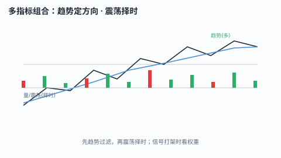

# 模块 G：多指标组合与策略（框架 / 共振 / 模板）

> 对应 01 总纲 模块 G 的 **G1~G3**。前面学了「零件」，这一篇把零件装成「一台能跑的机器」。

## G1 趋势 + 震荡框架（先过滤，再择时）

- **定义**：用趋势指标（模块 D：ADX/SAR/均线）先判「能不能做趋势单」，再用震荡指标（模块 E）在趋势里找「回调进场点」。
- **计算口径**：`趋势过滤（ADX>25 或 均线多头排列）∧ 触发器（RSI 回落 / 回踩均线）`。
- **常见用法**：多头排列里等 RSI 回 50 再买；ADX 低时切均值回归（布林带收口突破）。
- **坑与误区**：框架是「逻辑」不是「参数」；过滤+触发会「入场更晚、错过前段」；两指标可能矛盾（趋势 vs 超买）。
- **最小验证（BTC）**：「均线多头 + RSI<50 回调买」 vs「RSI<30 无脑抄底」，比期望、胜率、回撤。

## G2 信号共振 / 加权

- **定义**：多个独立信号「同时同向」= 共振，质量更高；也可按历史胜率加权成「综合分」。
- **计算口径**：共振 = 各信号同向的**数量/权重**；权重可用「历史夏普」或「相关度低」来定。
- **常见用法**：趋势 + 量 + 费率三件套同向才下单；用「综合分>阈值」当触发。
- **坑与误区**：高度相关的指标（如 RSI 与 KDJ）「共振」是伪独立；加权参数易过拟合（模块 H）。
- **最小验证（BTC）**：统计「3 信号共振」 vs「2 信号」 vs「单信号」的胜率/盈亏比，看共振是否真提升质量。

## G3 策略模板（触发 / 入场 / 出场 / 仓位）

- **定义**：一个完整策略 = ① 触发（信号）② 入场（价/量确认）③ 出场（止盈/止损/时间）④ 仓位（风险定额）。四件缺一不可。
- **计算口径**：每段都要「可量化、可回测」；出场用 ATR/斐波那契（A8）定距离。
- **常见用法**：把 G1/G2 的信号套进模板，得到「可执行规则」，再进模块 I 回测。
- **坑与误区**：只有触发没有出场的策略 = 没完成；「止损在哪」必须在入场前定好；回测别只挑「好看」的样本段。
- **最小验证（BTC）**：把 G1 框架写成 4 段规则，跑 3 年 4h 回测，输出 胜率/盈亏比/最大回撤/夏普，存档进 `E:\2026\jevis\quantify`。

## 本篇小结

| 知识点 | 核心读盘点 |
| --- | --- |
| G1 框架 | 先趋势过滤、再震荡择时 |
| G2 共振 | 独立信号同向，加权防过拟合 |
| G3 模板 | 触发/入场/出场/仓位 四段齐 |

> 组合的意义不是「指标越多越好」，而是**降低单一指标的失效概率**。下一篇讲「亏多少、开多大」。

---

::: info 系列导航
**上一篇**：[13 模块 F：OI / 资金费率 / 链上资金流](./13-模块F-OI与资金费率.md)
**下一篇**：[15 模块 G：止损止盈与仓位](./15-模块G-止损止盈与仓位.md)
:::
