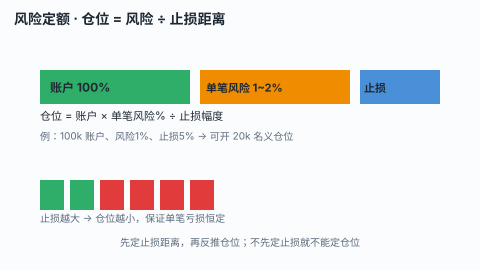

# 模块 G：止损止盈与仓位（风险定额 / 出场方法）

> 对应 01 总纲 模块 G 的 **G4~G5**。策略赚不赚钱，一半在信号、一半在**怎么亏、亏多少、开多大**——风险决定能活多久。

## G4 风险定额仓位（Risk-based Sizing）

- **定义**：每笔交易只允许亏「账户的固定百分比」（常 0.5%~2%），再按止损距离反推仓位。
- **计算口径**：`仓位 = 账户 × 单笔风险% ÷ 止损幅度`。例：10 万、风险 1%、止损 5% → 可开 2 万名义（20k/0.05）。
- **常见用法**：先定止损点，再定仓位；波动大（ATR 高）自动减小仓位；连亏后风险定额自动控回撤。
- **坑与误区**：「先开仓再找止损」顺序错了；风险% 定太高（>3%）一次连亏就重伤；仓位要含手续费与滑点。
- **最小验证（BTC）**：同一信号，风险 0.5%/1%/2% 三档回测，看总收益 vs 最大回撤的权衡（风险越小回撤越小但收益也小）。

## G5 止损 / 止盈方法

- **定义**：止损 = 「证伪就出」的距离；止盈 = 「目标/移动」的出场。常见：固定 ATR 止损、斐波那契回撤止损、移动止损（SAR/均线）、分批止盈。
- **计算口径**：止损常用 1~3×ATR（模块 D3）；止盈用风险回报比（RRR）如 1:2、1:3，或移动跟踪。
- **常见用法**：ATR 止损 + 移动止盈（让利润奔跑）；大趋势用 SAR 跟踪；关键位（筹码峰/斐波那契）分批止盈。
- **坑与误区**：止损越近越容易被扫、越远越扛；「止盈太早」把大趋势单做成小单；移动止损在插针市场会被反复扫。
- **最小验证（BTC）**：对同一信号测「止损 2/3/4×ATR」×「RRR 1:1/1:2/1:3」九宫格，找**夏普最高**而非「赚最多」的那格；重点看插针期被扫次数。

## 本篇小结

| 知识点 | 核心读盘点 | 易错 |
| --- | --- | --- |
| G4 仓位 | 风险定额，先止损后仓位 | 顺序反、风险% 过高 |
| G5 出场 | ATR/斐波/移动/分批 | 止盈太早、插针扫损 |

> 风险管理的本质：**用固定的单笔亏损，换长期的存活率**。下一篇进入「怎么证明它不是过拟合」。

---

::: info 系列导航
**上一篇**：[14 模块 G：多指标组合与策略](./14-模块G-多指标组合与策略.md)
**下一篇**：[16 模块 H：统计与稳健性](./16-模块H-统计与稳健性.md)
:::
