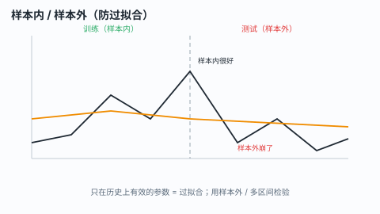

# 模块 H：统计与稳健性（过拟合 / 成本 / 压力 / 指标）

> 对应 01 总纲 模块 H 的 **H1~H5**。策略「历史好看」不等于「未来能用」——这一篇教你怎么**证伪自己**。

## H1 过拟合与样本内外

- **定义**：过拟合 = 参数只在「历史这段」最优；样本内（训练）表现 ≠ 样本外（未来）表现。
- **计算口径**：把数据切 训练段 / 测试段（或按年分）；参数在训练段调、在测试段验。
- **常见用法**：调参只用训练段；「测试段仍正期望 + 不明显比训练差」才算稳健。
- **坑与误区**：反复调参到「最好看」= 自欺；测试段一旦看过就会污染（不能反复重调）；参数要「不敏感」（小改不崩）。
- **最小验证（BTC）**：3 年按 1 年切 4 段，调参只用前 3 段、最后 1 段验；再看「参数 ±20%」时绩效是否稳定。

## H2 指标计算的正确性

- **定义**：用「自己的指标实现」前，先和已知正确的库对拍（MA/MACD/RSI/布林带都有标准算法）。
- **计算口径**：逐根对齐；EMA 初值、Wilder 平滑、ATR 的 TR 定义是常见出错点。
- **常见用法**：先跑 100 根与基准库比对误差；不一致就别回测。
- **坑与误区**：实现 bug 会让「好策略」变「坏策略」或反之；不同库对「首根 EMA」处理不同。
- **最小验证（BTC）**：用基准库算 RSI/MACD，和自己实现比对 1e-6 误差；不达标先修实现。

## H3 交易成本 / 滑点 / 手续费

- **定义**：回测必须计入**手续费 + 滑点**，否则「高频信号」会被成本吃掉。
- **计算口径**：手续费（taker/maker 分档）、滑点（按流动性估算，BTC 小单可忽略、插针放大）、资金费率（永续）。
- **常见用法**：保守假设（taker + 2~5 个 tick 滑点）；看「成本后」还剩多少期望。
- **坑与误区**：回测只算手续费不算滑点 = 高估；高频策略对成本极敏感；插针时段滑点巨大。
- **最小验证（BTC）**：同一策略「0 成本 vs 0.1% + 3tick」两版回测，看净收益差异；高频信号大概率成本后变负。

## H4 压力测试 / 极端行情

- **定义**：把策略放到「黑天鹅段」（2020-03、2021-05、2022-06、2024-02 等）看会不会被一波打死。
- **计算口径**：统计极端段的单笔最大亏损、连续亏损、回撤；对照全段。
- **常见用法**：极端段「亏得有限」才合格；用 ATR 仓位 + 硬止损限制极端损失。
- **坑与误区**：只看全段夏普、不看极端段 = 侥幸；黑天鹅里止损可能「跳空打不到」。
- **最小验证（BTC）**：把 3 年里的 4 个极端段单独拎出来算绩效 + 最大回撤，与全段对比，看策略是否「死在极端段」。

## H5 绩效指标（夏普 / 最大回撤 / 盈亏比）

- **定义**：夏普 = (年化收益−无风险)/年化波动；最大回撤 = 峰值到谷值的最大跌幅；盈亏比 = 平均盈利/平均亏损。
- **计算口径**：夏普常用日收益年化（×√365，BTC 7×24）；回撤要「净值曲线」口径。
- **常见用法**：夏普>1 合格、>2 优秀；最大回撤定「你能不能扛住」；盈亏比与胜率合看（盈亏比低靠胜率、高靠少数大单）。
- **坑与误区**：只看「赚了多少」不看回撤/夏普 = 幸存者视角；7×24 年化要用 365 不是 252；样本短夏普不稳。
- **最小验证（BTC）**：每个候选策略都出「夏普/最大回撤/盈亏比/胜率/最大连亏」一张卡，按**夏普 + 回撤**排序定最终。

## 本篇小结

| 知识点 | 核心读盘点 | 易错 |
| --- | --- | --- |
| H1 过拟合 | 训练/测试分段，参数不敏感 | 反复重调自欺 |
| H2 计算 | 先与基准库对拍 | 实现 bug 误判 |
| H3 成本 | 手续费+滑点+费率 | 只算手续费 |
| H4 压力 | 黑天鹅段单独验 | 只看全段 |
| H5 指标 | 夏普/回撤/盈亏比排序 | 用错年化 |

> 模块 H 是「防自欺」工具：一个策略要过 计算正确 + 成本后仍正 + 极端不死 + 样本外稳 四关，才进模块 I。

---

::: info 系列导航
**上一篇**：[15 模块 G：止损止盈与仓位](./15-模块G-止损止盈与仓位.md)
**下一篇**：[17 模块 I：实盘验证与复盘](./17-模块I-实盘验证与复盘.md)
:::
