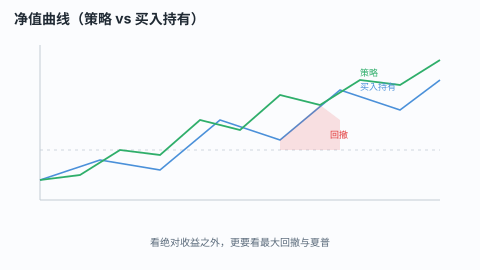

# 模块 I：实盘验证与复盘（回测框架 / 模拟 / 接入 / 记录）

> 对应 01 总纲 模块 I 的 **I1~I4**。理论走到「能跑、能看、能记录、能迭代」。这是整个系列的落点，也对应 `E:\2026\jevis\quantify` 工程。

## I1 回测框架（可复现）

- **定义**：一套「数据 → 信号 → 撮合 → 绩效」的可复现流水线，参数/随机性/时间都可锁。
- **计算口径**：固定数据版本（含时间戳）、信号按「收盘后」生成（防前视）、撮合按「下一根开盘/收盘价」；输出绩效卡片（模块 H5）。
- **常见用法**：每次改策略跑同一套 3 年基准；结果存档（日期/参数/指标）。
- **坑与误区**：前视偏差（用了未来数据）是最常见 bug；「收盘生成、下一根成交」要贯彻；数据含插针要处理。
- **最小验证（BTC）**：在 `quantify` 里跑通 4h 基准策略，输出「夏普/回撤/盈亏比」卡片并存档；换参数重跑结果可复现。

## I2 模拟盘 / 小仓验证（实盘化前）

- **定义**：先用「模拟盘 / 小资金实盘」验证「回测 vs 实盘」的差距（滑点、延迟、成交）。
- **计算口径**：实盘成交的「滑点 + 延迟 + 手续费」与回测假设逐项对账；跑 4~8 周再放量。
- **常见用法**：小仓（风险 0.25~0.5%）跑 4 周，记录实盘绩效 vs 回测绩效差。
- **坑与误区**：模拟盘「假成交」比真实好；小仓也有真实滑点；别「一上实盘就全仓」。
- **最小验证（BTC）**：策略小仓实盘 4 周，输出「实盘 vs 回测」的净值差与滑点统计，判断是否「实盘打对折」。

## I3 实盘接入（执行链路）

- **定义**：把信号 → 下单 → 撤改 → 风控 接成一条**可监控**链路；含异常（断线、拒单、部分成交）处理。
- **计算口径**：下单前再核「风险定额仓位」；每笔留痕（时间/价/量/理由）；风控上限（最大持仓/单日最大亏）。
- **常见用法**：信号只在「风控通过」时发单；断线后「只撤不开」；异常告警。
- **坑与误区**：没做「异常成交」处理会重复下单；风控上限没设 = 一次事故全损；延迟会让止损「跳空打不到」。
- **最小验证（BTC）**：接入 1 个所，先「半自动」（信号提示 + 人工确认下单）跑 2 周，再上全自动；全程留痕。

## I4 复盘记录（可迭代）

- **定义**：每笔/每周复盘：信号对不对、执行对不对、盈亏归因（哪类行情赚/亏）。
- **计算口径**：按「趋势/震荡/极端」分桶统计绩效；记录「偏差」（实盘 vs 规则）的原因。
- **常见用法**：周报复盘 + 月度「绩效卡」更新；把失效模式写回模块（如「极端段止损被跳空」→ 调 H4）。
- **坑与误区**：不复盘 = 反复犯错；「归因到运气」会掩盖真 bug；复盘要落到「下一步改什么」。
- **最小验证（BTC）**：建「交易日志 + 周复盘」模板，每月出一份绩效卡，把失效项转成下一版策略的待改清单。

## 本篇小结

| 知识点 | 核心读盘点 | 易错 |
| --- | --- | --- |
| I1 回测 | 可复现、防前视 | 前视偏差 |
| I2 模拟 | 实盘 vs 回测对账 | 假成交、一上就全仓 |
| I3 接入 | 风控 + 留痕 + 异常 | 重复下单、无上限 |
| I4 复盘 | 分桶归因 + 待改清单 | 归因到运气 |

> 全系列到此。回测只是「历史体检」，**小仓实盘 + 持续复盘**才把理论真正落到账户上。需要时回到 [01 总纲](./01-量化系统性学习计划.md) 查任意模块。

---

::: info 系列导航
**上一篇**：[16 模块 H：统计与稳健性](./16-模块H-统计与稳健性.md)
**下一篇**：（全系列完）回到 [01 量化学习总纲与理论清单](./01-量化系统性学习计划.md)
:::
