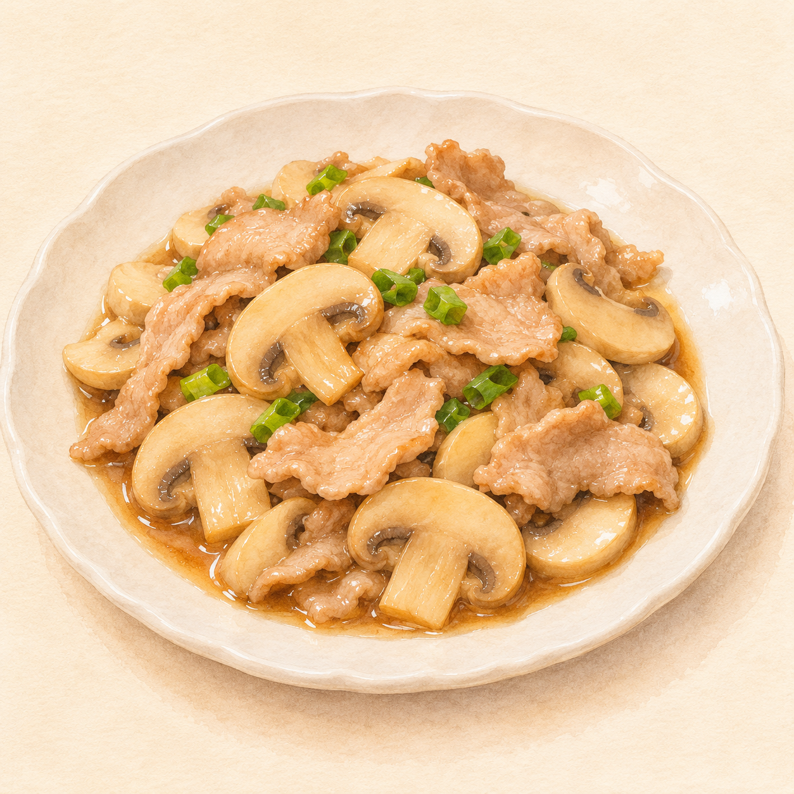
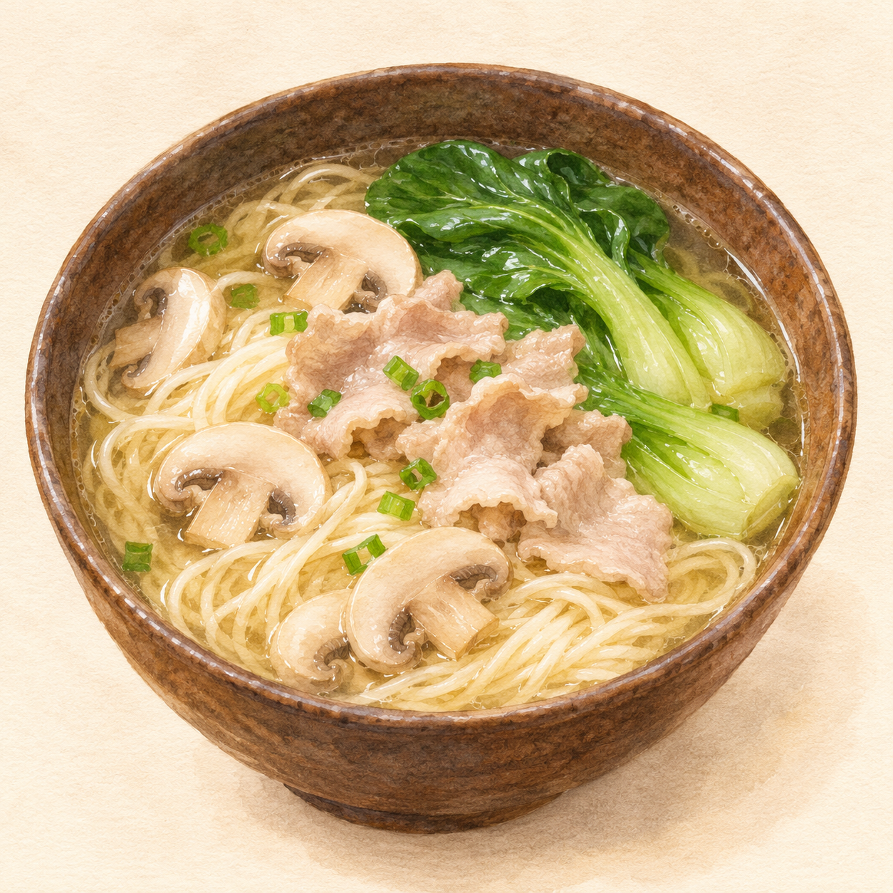
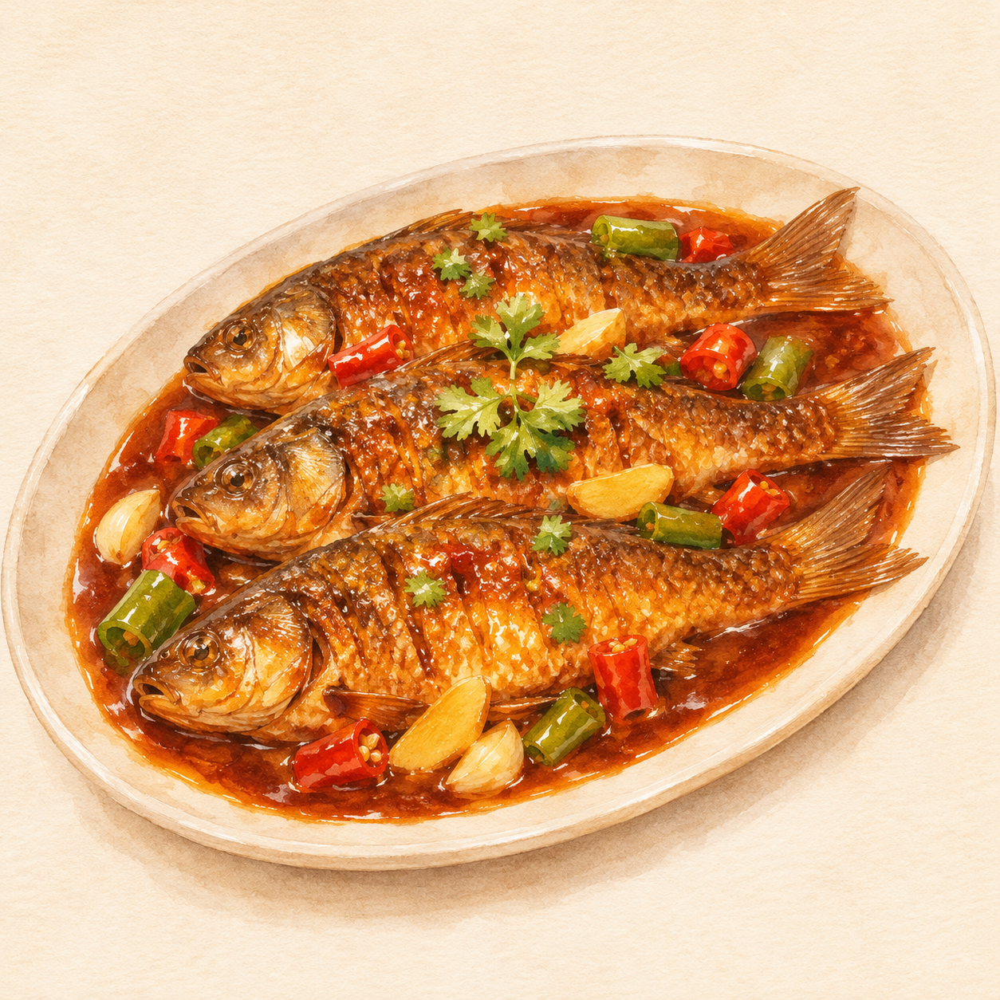
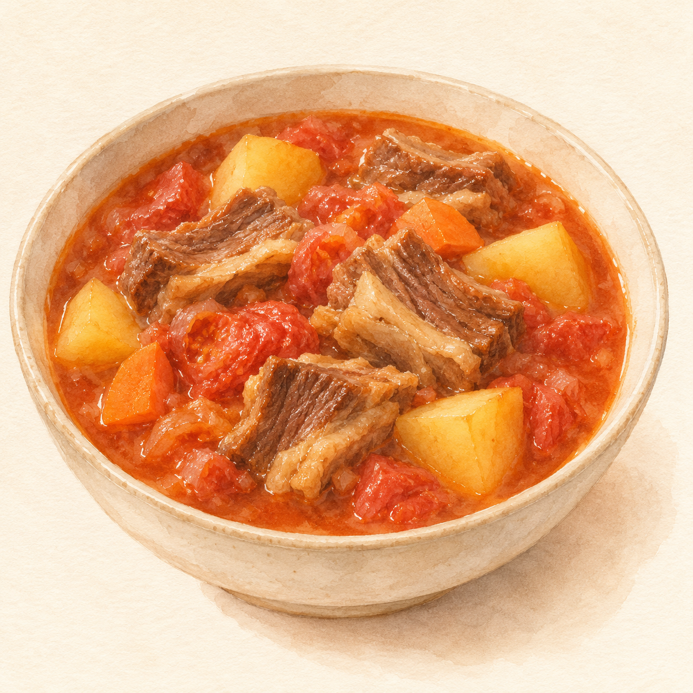

<!-- markdownlint-configure-file { "MD024": { "siblings_only": true } } -->

> 把家里爱吃的味道记下来，下次做饭时，翻开就能照着做。

## 今天吃什么

| 菜谱                                              | 风味                | 关键一步                   |
| ------------------------------------------------- | ------------------- | -------------------------- |
| [口菇炒肉](#口菇炒肉)                             | 菌菇鲜香 · 汤汁拌饭 | 肉片先炒盛出，再与口菇合炒 |
| [蘑菇青菜鲜汤面](#蘑菇青菜鲜汤面)                 | 清鲜汤底 · 一碗管饱 | 菜茎先炒，肉片和菜叶后下   |
| [红烧鱼](#红烧鱼)                                 | 酱香浓郁 · 鲜辣下饭 | 鱼身吸干水分，煎定型再翻面 |
| [番茄土豆胡萝卜炖牛肋条](#番茄土豆胡萝卜炖牛肋条) | 番茄酸甜 · 牛肉浓香 | 番茄炒出沙，再入高压锅炖煮 |

_因为写这篇的时候已经吃完了，所以让ai生成，但是基本是那个意思，实际以自家出锅为准。_

## 口菇炒肉

### 食材清单

| 类别 | 食材与用量                                       |
| ---- | ------------------------------------------------ |
| 主料 | 口菇 500 g、前腿肉 250 g                         |
| 腌肉 | 小苏打 1 小勺、盐 1 小勺、生抽、蚝油、胡椒粉、油 |
| 炒制 | 油、盐适量                                       |

### 下锅前准备

- **口菇**：洗净切片，新鲜的菇柄也可以吃。
- **猪肉**：切成肉丝或薄肉片，加 1 小勺小苏打抓匀，静置 5 分钟后洗净，沥干并尽量吸去水分。
- **腌肉**：加入 1 小勺盐、生抽、蚝油和胡椒粉抓匀，喷一点油，再抓匀一次。

### 制作步骤

1. **先炒肉**。热锅冷油，下肉翻炒，变色后再炒 1 分钟，盛出备用。这一步不再放盐。
2. **炒出口菇汁**。下口菇，放一点盐，炒至出汁。
3. **合炒收汁**。把肉倒回锅中，小火收汁后盛盘。

> **好吃的关键**：留一点鲜香汤汁，拌饭很合适。

---

## 蘑菇青菜鲜汤面

### 食材清单

| 类别 | 食材与用量                                  |
| ---- | ------------------------------------------- |
| 主料 | 口菇 500 g、前腿肉 250 g、面条适量          |
| 配菜 | 奶油白菜或上海青、小葱一把、姜丝 3 根       |
| 腌肉 | 盐 1 小勺、生抽、少量蚝油、胡椒粉、少量淀粉 |
| 汤底 | 油少许、热水；盐、生抽、老抽按需添加        |

### 下锅前准备

- **口菇**：洗净切片，新鲜的菇柄也可以吃。
- **猪肉**：切薄片，洗净、沥干并吸去水分；加入 1 小勺盐、生抽、少量蚝油、胡椒粉和一点淀粉，抓匀。
- **青菜**：茎叶分开，稍微切两刀；菜叶可切碎些。
- **葱姜**：小葱切好，姜切丝。

### 制作步骤

1. **炒香汤底**。热锅喷少许油，小火炒口菇和青菜茎，加入 3 根姜丝和少量小葱。
2. **加水下面**。炒出汁后加入热水，烧开后放入面条。
3. **下肉与菜叶**。面快熟时，将肉片一片片放入，先不要搅动；再下青菜叶，煮至肉片、面条和青菜熟透。
4. **尝味出碗**。先尝原味，觉得淡再加盐、生抽和几滴老抽；最后在碗里撒一点小葱提鲜。

> **调味笔记**：原做法的补味参考是盐 1 勺、生抽 1 勺、老抽几滴，可根据汤量和口味酌情添加。

---

## 红烧鱼

### 食材清单

| 类别 | 食材与用量                                       |
| ---- | ------------------------------------------------ |
| 主料 | 鲫鱼 3 条                                        |
| 配料 | 葱、姜、蒜、青红椒、香菜                         |
| 酱料 | 豆瓣酱或火锅底料一块                             |
| 调味 | 生抽 2 勺、老抽 1 勺、糖半勺、蚝油一挤、陈醋几滴 |
| 其他 | 油、热水、少量淀粉水                             |

### 下锅前准备

- **清理鱼**：去除内脏，洗净腹内黑膜。
- **腌制**：鱼身两面划花刀，准备一碗葱姜蒜水，内外抹匀腌制。
- **配菜**：腌鱼时切好青红椒，备好香菜。
- **吸干水分**：取出鱼身上附着的葱姜，倒掉腌出的血水，用厨房纸吸干鱼身。

### 制作步骤

1. **煎鱼定型**。锅中多放一点油，油热后逐条下鱼，避免油温下降过快。大火煎约 3 分钟，待表面焦黄起壳再翻面；两面煎好后盛出。
2. **炒出红油**。重新起锅，油热后转小火，炒香豆瓣酱或火锅底料，炒出红油后加入青红椒，稍微翻炒。
3. **加水红烧**。放入煎好的鱼，加热水没过鱼身；加入 2 勺生抽、1 勺老抽、半勺糖和一挤蚝油。
4. **焖煮收汁**。加盖大火烧 20～30 分钟，最后加少量淀粉水和几滴陈醋收汁，撒上香菜。

> **好吃的关键**：鱼皮煎到定型再翻面，尽量保持鱼身完整。

---

## 番茄土豆胡萝卜炖牛肋条

### 食材清单

| 类别 | 食材与用量                                                      |
| ---- | --------------------------------------------------------------- |
| 主料 | 牛肋条 1 根，约 350～500 g，最好带一点肥肉，有牛油更香          |
| 蔬菜 | 本地番茄 5 个、土豆 2 个、胡萝卜半根（可不加）                  |
| 香料 | 桂皮一小片、八角 1 个、生姜约 8 片                              |
| 调味 | 生抽、盐 3 勺（原做法用量）、少许胡椒粉、少量十三香或南德调味料 |
| 其他 | 猪油一小块、植物油少许、热水；喜欢辣味可加干辣椒 2 根           |

### 下锅前准备

- **牛肋条**：冷冻的先解冻；新鲜的稍微清洗表面，用厨房纸吸干。
- **番茄去皮**：划十字刀，放入热水中烫约 1 分钟，剥皮。
- **切块**：番茄、土豆和牛肋条切成乒乓球大小的块；胡萝卜切块。
- **番茄分两种大小**：将约 3/5 的番茄块进一步切成指甲大小，便于炒出沙。

### 制作步骤

1. **煎香牛肉**。热锅，放一小块猪油和少许植物油。油热后下姜片和牛肉，中小火煎约 1 分钟后翻面，煎至两面金黄；加入桂皮和八角翻炒几下，盛出。
2. **煎土豆与胡萝卜**。煎锅不洗，继续加热，下土豆和胡萝卜，中小火炒至土豆中心不再发白、边缘略带焦黄，盛出。
3. **炒番茄出沙**。煎锅不洗，继续加热，下番茄炒出沙；倒回土豆、胡萝卜和牛肋条，翻炒几下，加热水没过食材。
4. **转入高压锅**。倒入高压锅，加入生抽、盐、少许胡椒粉，以及一点十三香或南德；喜欢辣味可加 2 根干辣椒。
5. **上汽后计时**。上汽后煮 10 分钟，等气压阀自动下降后再开盖出锅。

> **自家风味**：胡萝卜按喜好添加；牛肋条带一点肥肉，炖出来更香。盐量沿用原记录，实际可按水量、勺子大小和口味调整。

